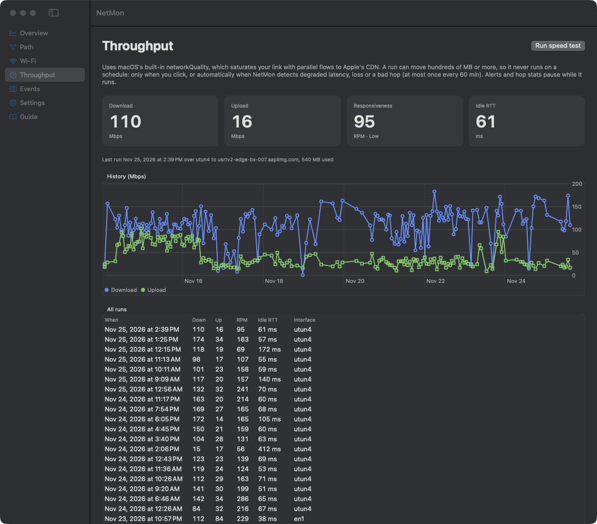

<p align="center">
  
</p>

# NetMon

A small native macOS menu bar app that monitors your internet connection.

- **Latency** to 1.1.1.1 and 8.8.8.8 (configurable), pinged once a second: last, avg, min, max, loss, jitter.
- **IPv6**: while your Mac has IPv6, every target gets an IPv6 twin on the same network, so IPv6-only problems show up.
- **mtr-style path analysis**: every hop is probed continuously and kept as a rolling window of 100 probes. The app then works out which hop is actually at fault (see below).
- **Wi-Fi analyzer**: signal, noise, SNR, link rate, channel/band/width and roaming every 2 s; periodic scans of nearby access points with a channel map, per-channel load scores, access point load (BSS Load) when broadcast, and a channel suggestion. It also tells you whether Wi-Fi explains a slow first hop.
- **Throughput** via macOS's built-in `networkQuality`: download, upload, responsiveness (RPM) and idle RTT.
- **History & charts**: 15m / 1h from raw samples, 24h / 7d from per-minute rollups kept on disk.
- **Notifications** for connection down/restored, sustained loss, latency or jitter, bad hops, and slow downloads.

For how everything works in detail (measurement, diagnosis rules, alerts, data files, the API and the source layout), see **[docs/HOW-IT-WORKS.md](docs/HOW-IT-WORKS.md)**. The same guide is in the app under **Guide**.

No root, no dependencies. Probes use an unprivileged ICMP datagram socket, which macOS allows for normal users. It still receives the TTL-exceeded replies a hop trace needs.

## Screenshots

### Connection overview

Live latency, packet loss, and recent connection events in one window.


### Hop-by-hop diagnosis

Find where a problem carries forward through the route, with VPN context and harmless router anomalies called out separately.


### Throughput history

Download, upload, responsiveness, and idle latency from macOS networkQuality.



## Install

Requires macOS 15 (Sequoia) or later on Apple Silicon.

**Homebrew:**

```bash
brew install --cask 1eq/tap/netmon
```

This also puts the `netmon` CLI on your PATH.

**Download:** get `NetMon-<version>.zip` from [Releases](https://github.com/1eq/netmon/releases), unzip it, and drag NetMon to Applications. Releases are signed and notarized.

**From source** (needs Xcode 16+ or the Command Line Tools with Swift 6):

```bash
./scripts/build-app.sh            # builds build/NetMon.app
./scripts/build-app.sh --install  # also copies to /Applications, links the CLI and launches it
```

Source builds are ad-hoc signed, so macOS may ask for Location permission again after each rebuild.

It runs as a menu bar item showing a coloured dot (green/orange/red, blue during a speed test) and the current latency. Click it for a summary. **Open NetMon** opens the full window (Overview, Path, Wi-Fi, Throughput, Events, Settings, Guide). To start it automatically, turn on **Launch at login** in Settings.

The first notification will ask for permission. If you miss it, allow NetMon in System Settings › Notifications.

NetMon also asks for **Location Services** permission. macOS shows Wi-Fi network names, access point addresses and access point load only to apps with it. NetMon never reads or stores your location. Signal, channel and congestion data work without it. If you declined, turn it on in System Settings › Privacy & Security › Location Services.

## Wi-Fi

The Wi-Fi screen samples the link every 2 s and scans for nearby access points every 10 minutes (configurable; 0 means only on demand). A scan takes the radio off your channel for 5–30 s, so it's kept infrequent, and alerts and hop stats pause for a minute after each one, as they do after a speed test. Each channel your router could use gets a score: roughly how many strong networks share or overlap its airtime. NetMon suggests a channel when one is clearly quieter; only the router can change it. NetMon can't see true airtime use, retry counts or the MCS index, because macOS doesn't expose them without monitor mode. See [docs/HOW-IT-WORKS.md](docs/HOW-IT-WORKS.md#wi-fi-analysis) for the rules.

## How bad hops are identified

The rule mtr experts use: **a problem is only real if it carries forward to later hops.**

Routers rate-limit and deprioritise the ICMP replies they generate themselves. A hop can show 60% "loss" or 300 ms while the hops after it are clean. That is the router being too busy to answer you, not dropping or delaying your traffic. NetMon lists these under "Harmless anomalies".

What it flags:

| Finding | Rule |
|---|---|
| Packet loss starts at hop N | First hop from which every later hop, including the destination, shows ≥ half the destination's loss |
| Latency jumps at hop N | Largest step up (≥ 25 ms or +50%) that persists to the destination. Info only, unless destination latency is over your threshold |
| High jitter from hop N | Same carry-forward rule applied to jitter |
| Local network is slow | Hop 1 (your router) averages > 15 ms or spikes > 150 ms. Usually Wi-Fi or bufferbloat |
| Not answering | The destination stops replying. Reports the last hop that still answers |

Each finding says where the hop is: your router, a private/CGNAT address (your LAN or ISP access network), near you (ISP), or upstream.

**VPNs:** when traffic leaves through a tunnel interface (`utun*`, `ipsec*`, `wg*`…), only the hops inside the tunnel are visible. The first visible hop carries the whole tunnel's latency. NetMon detects this, says so, and doesn't blame your LAN.

## Speed tests

`networkQuality` saturates the link with parallel flows to Apple's CDN. A run takes 20–40 s and moves hundreds of MB or more. It therefore **never runs on a schedule**. It runs only:

- when you click **Speed test**, or
- automatically when another signal fires: a degraded-connection alert or a bad-hop finding. At most once per cooldown (default 60 min). Configurable, or turn it off.

While a test runs, and for a minute after, alerts and hop statistics pause, so the test's own load doesn't trigger false alarms.

## Using it from Claude (MCP + CLI)

The app serves its live data on a loopback-only HTTP API (`127.0.0.1`, random port). The same `NetMon` binary works as an **MCP server** and a **JSON CLI** that talk to that API. Both launch the app if it isn't running.

```bash
claude mcp add --scope user netmon -- /Applications/NetMon.app/Contents/MacOS/NetMon --mcp
```

| MCP tool | CLI | What it does |
|---|---|---|
| `netmon_status` | `netmon status` | Health, 60 s / 5 min latency, loss and jitter, key findings, last speed test, recent events |
| `netmon_path` | `netmon path [target]` | mtr-style hop table and diagnosis |
| `netmon_history` | `netmon history [target] [15m\|1h\|24h\|7d]` | Bucketed latency and loss over time |
| `netmon_wifi` | `netmon wifi [--scan] [range]` | Wi-Fi link, findings, neighbors, channel load, recommendation, signal history |
| `netmon_events` | `netmon events [limit]` | Alerts, recoveries, speed tests |
| `netmon_throughput_history` | `netmon throughput [limit]` | Past speed tests |
| `netmon_run_speed_test` | `netmon speedtest [--no-wait]` | Runs networkQuality (heavy; see above) |
| `netmon_trace` | `netmon trace <host> [cycles]` | One-off trace and diagnosis to any host |
| `netmon_reset_path` | `netmon reset [target]` | Clears hop stats and rediscovers routes |
| `netmon_open_window` | `netmon open [section]` | Opens the window on a section (overview, path, wi-fi, throughput, events, settings, guide) |
| `netmon_get_settings` / `netmon_update_settings` | `netmon settings` / `netmon set k=v …` | Read or change settings (range-checked) |

`scripts/build-app.sh --install` symlinks the CLI to `~/.local/bin/netmon`. Tool definitions live in one place (`Sources/NetMon/API/Tools.swift`), so MCP and the CLI stay in sync. The MCP server also sends Claude instructions on how to read hop data (the carry-forward rule, VPN caveats, and when a speed test is worth its cost).

**Security:** the API binds to `127.0.0.1` only and requires a random bearer token. The token is regenerated at each launch and written to `~/Library/Application Support/NetMon/api.json` with mode `0600`, so other users and web pages can't reach it.

## Data

`~/Library/Application Support/NetMon/` holds JSON Lines files: `rollups.jsonl` (per-minute latency per target), `wifi.jsonl` (per-minute Wi-Fi signal, noise, link rate, channel), `throughput.jsonl`, `events.jsonl`. They're pruned to the history window in Settings (default 7 days).

## Development

```bash
swift build && swift test
```

`swift run` works for quick iteration, but notifications and Location Services only work from the bundled `.app`. To share a test build with someone, `scripts/package-test.sh` writes an app zip (with an installer and [docs/TESTING.md](docs/TESTING.md)) and a source zip to `dist/`.

## Contributing

Issues and pull requests are welcome; see [CONTRIBUTING.md](CONTRIBUTING.md). Report security problems privately as described in [SECURITY.md](SECURITY.md). Maintainers: [docs/RELEASING.md](docs/RELEASING.md).

## License

[MIT](LICENSE)
