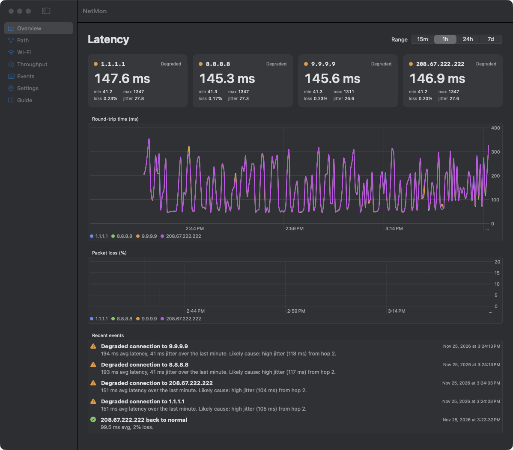
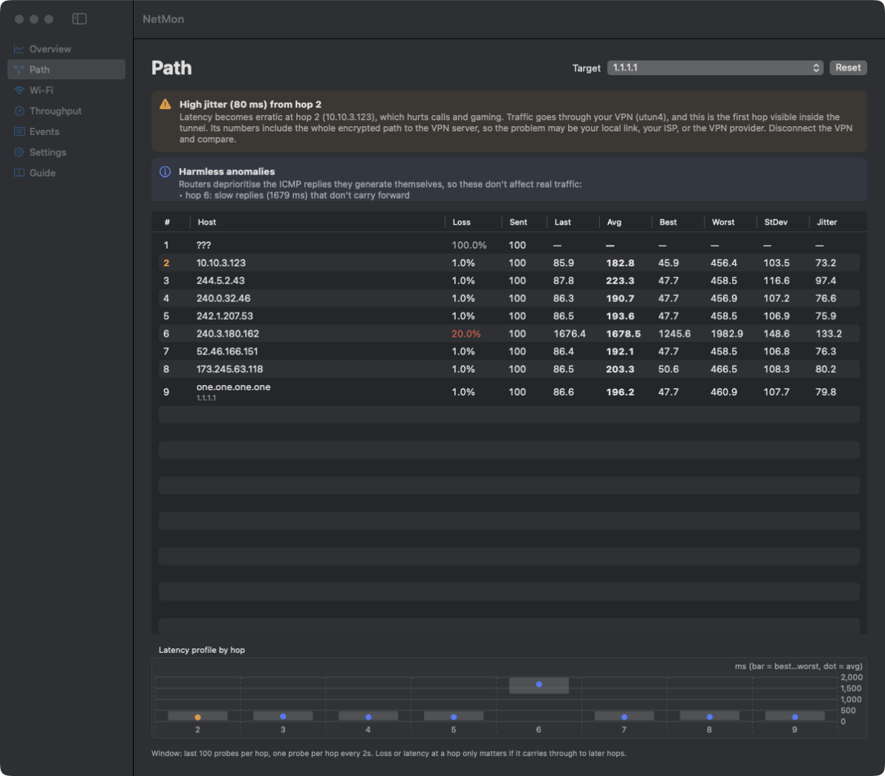

<p align="center">
  
</p>

# NetMon

**Your speed test looks fine. Your calls don't.**

NetMon watches your connection from your Mac's menu bar, tracks latency and packet loss, and helps you investigate where problems start. When a call freezes, a game lags, or your work VPN feels slow, you have connection history to inspect—even after things recover.

**Native Mac app. Free and open source. No account required.**

[Get NetMon](#get-netmon) · [See it in action](#screenshots) · [CLI and Claude integration](#using-it-from-claude-mcp--cli)

## Understand your connection

- **Catch problems a speed test can miss.** Watch response times, packet loss, and jitter—the variation in delay that can make calls and games unreliable.
- **Look back after a dropout.** Explore latency and loss over 15 minutes, an hour, a day, or a week, with a record of connection alerts and recoveries.
- **Investigate where trouble starts.** Follow the route to your destination, with explanations of problems that persist through later hops and router replies that are harmless. VPN context helps you understand what the app can see.
- **Check your Wi-Fi.** Inspect signal quality, nearby networks, and channel congestion, with suggestions when a quieter channel is available.
- **Keep an eye on things from the menu bar.** See connection health and current latency at a glance, then open the full window when you need more detail.
- **Compare with a speed test.** Measure download, upload, and responsiveness with macOS's built-in test, and review previous results.

## Get NetMon

Requires **macOS 15 (Sequoia) or later on Apple Silicon**.

**[Download a test build for Mac](https://github.com/1eq/netmon/releases)**

Choose the app archive (`NetMon-<version>.zip`) and follow that release's installation instructions. The currently published builds are pre-releases and are **not notarized**. They predate the Wi-Fi analyzer and the screenshots below; [build from source](#development) for the latest features.

## Getting started

1. Open NetMon and look for the coloured dot and latency in your menu bar.
2. Click it for a quick summary, or choose **Open NetMon** for charts and diagnostics.
3. Leave it running so it can capture intermittent problems. When something feels slow, check **Overview**, then **Path** and **Wi-Fi** for clues.

To start it automatically, turn on **Launch at login** in Settings. You can also configure targets, alert thresholds, and history retention there.

**Permissions:** notifications let NetMon tell you when connection conditions change. Location Services lets macOS reveal Wi-Fi network names and access point details; NetMon never reads or stores your location. Signal, channel, and congestion data work without it. You can manage both permissions in System Settings.

For measurement details, diagnosis rules, alerts, and the API, see [How it works](docs/HOW-IT-WORKS.md). The same guide is available in the app under **Guide**.

## Screenshots

### Connection overview

See when your connection became unreliable, with latency, packet loss, and recent events in one window.



### Hop-by-hop diagnosis

Find where a problem carries forward through the route, with VPN context and harmless router anomalies called out separately.



### Throughput history

Compare download and upload speeds with responsiveness and idle latency over time.


## Wi-Fi

The Wi-Fi screen samples the link every 2 s and scans for nearby access points every 10 minutes (configurable; 0 means only on demand). A scan takes the radio off your channel for 5–30 s, so it's kept infrequent, and alerts and hop stats pause for a minute after each one, as they do after a speed test. Each channel your router could use gets a score: roughly how many strong networks share or overlap its airtime. NetMon suggests a channel when one is clearly quieter; only the router can change it. NetMon can't see true airtime use, retry counts or the MCS index, because macOS doesn't expose them without monitor mode. See [docs/HOW-IT-WORKS.md](docs/HOW-IT-WORKS.md#wi-fi-analysis) for the rules.

## Latency and history

NetMon pings configurable targets (1.1.1.1 and 8.8.8.8 by default) once a second, tracking last, average, minimum and maximum latency, loss, and jitter. When IPv6 is available, it also monitors an IPv6 target on the same network as each IPv4 target to help expose IPv6-only problems. The 15-minute and one-hour charts use raw samples; 24-hour and seven-day charts use per-minute history stored on disk.

## How bad hops are identified

The rule mtr experts use: **a problem is only real if it carries forward to later hops.**

Routers rate-limit and deprioritise the ICMP replies they generate themselves. A hop can show 60% "loss" or 300 ms while the hops after it are clean. That is the router being too busy to answer you, not dropping or delaying your traffic. NetMon lists these under "Harmless anomalies".

What it flags:

| Finding | Rule |
|---|---|
| Packet loss starts at hop N | First hop from which every later hop, including the destination, shows ≥ half the destination's loss |
| Latency jumps at hop N | Largest step up (≥ 25 ms or +50%) that persists to the destination. Info only, unless destination latency is over your threshold |
| High jitter from hop N | Same carry-forward rule applied to jitter |
| Local network is slow | Hop 1 (your router) averages > 15 ms or spikes > 150 ms. Usually Wi-Fi or bufferbloat |
| Not answering | The destination stops replying. Reports the last hop that still answers |

Each finding says where the hop is: your router, a private/CGNAT address (your LAN or ISP access network), near you (ISP), or upstream.

**VPNs:** when traffic leaves through a tunnel interface (`utun*`, `ipsec*`, `wg*`…), only the hops inside the tunnel are visible. The first visible hop carries the whole tunnel's latency. NetMon detects this, says so, and doesn't blame your LAN.

## Speed tests

`networkQuality` saturates the link with parallel flows to Apple's CDN. A run takes 20–40 s and moves hundreds of MB or more. It therefore **never runs on a schedule**. It runs only:

- when you click **Speed test**, or
- automatically when another signal fires: a degraded-connection alert or a bad-hop finding. At most once per cooldown (default 60 min). Configurable, or turn it off.

While a test runs, and for a minute after, alerts and hop statistics pause, so the test's own load doesn't trigger false alarms.

## Using it from Claude (MCP + CLI)

For developers and power users, NetMon also exposes its measurements through a JSON CLI and an MCP server. Query connection health from a terminal, or connect Claude Code to investigate using the app's live data.

The app serves its live data on a loopback-only HTTP API (`127.0.0.1`, random port). The same `NetMon` binary works as an **MCP server** and a **JSON CLI** that talk to that API. Both launch the app if it isn't running.

```bash
claude mcp add --scope user netmon -- /Applications/NetMon.app/Contents/MacOS/NetMon --mcp
```

| MCP tool | CLI | What it does |
|---|---|---|
| `netmon_status` | `netmon status` | Health, 60 s / 5 min latency, loss and jitter, key findings, last speed test, recent events |
| `netmon_path` | `netmon path [target]` | mtr-style hop table and diagnosis |
| `netmon_history` | `netmon history [target] [15m\|1h\|24h\|7d]` | Bucketed latency and loss over time |
| `netmon_wifi` | `netmon wifi [--scan] [range]` | Wi-Fi link, findings, neighbors, channel load, recommendation, signal history |
| `netmon_events` | `netmon events [limit]` | Alerts, recoveries, speed tests |
| `netmon_throughput_history` | `netmon throughput [limit]` | Past speed tests |
| `netmon_run_speed_test` | `netmon speedtest [--no-wait]` | Runs networkQuality (heavy; see above) |
| `netmon_trace` | `netmon trace <host> [cycles]` | One-off trace and diagnosis to any host |
| `netmon_reset_path` | `netmon reset [target]` | Clears hop stats and rediscovers routes |
| `netmon_open_window` | `netmon open [section]` | Opens the window on a section (overview, path, wi-fi, throughput, events, settings, guide) |
| `netmon_get_settings` / `netmon_update_settings` | `netmon settings` / `netmon set k=v …` | Read or change settings (range-checked) |

`scripts/build-app.sh --install` symlinks the CLI to `~/.local/bin/netmon`. Tool definitions live in one place (`Sources/NetMon/API/Tools.swift`), so MCP and the CLI stay in sync. The MCP server also sends Claude instructions on how to read hop data (the carry-forward rule, VPN caveats, and when a speed test is worth its cost).

**Security:** the API binds to `127.0.0.1` only and requires a random bearer token. The token is regenerated at each launch and written to `~/Library/Application Support/NetMon/api.json` with mode `0600`, so other users and web pages can't reach it.

## Data

`~/Library/Application Support/NetMon/` holds JSON Lines files: `rollups.jsonl` (per-minute latency per target), `wifi.jsonl` (per-minute Wi-Fi signal, noise, link rate, channel), `throughput.jsonl`, `events.jsonl`. They're pruned to the history window in Settings (default 7 days).

## Development

Needs Xcode 16+ or the Command Line Tools with Swift 6. NetMon has no external package dependencies and does not require root; its probes use unprivileged ICMP sockets.

```bash
git clone https://github.com/1eq/netmon.git
cd netmon
./scripts/build-app.sh            # builds build/NetMon.app
./scripts/build-app.sh --install  # also installs, links the CLI and launches it
```

Source builds are ad-hoc signed, so macOS may ask for Location permission again after each rebuild.

To build and run the tests:

```bash
swift build && swift test
```

`swift run` works for quick iteration, but notifications and Location Services only work from the bundled `.app`. To share a test build with someone, `scripts/package-test.sh` writes an app zip (with an installer and [docs/TESTING.md](docs/TESTING.md)) and a source zip to `dist/`.

## Contributing

Issues and pull requests are welcome; see [CONTRIBUTING.md](CONTRIBUTING.md). Report security problems privately as described in [SECURITY.md](SECURITY.md). Maintainers: [docs/RELEASING.md](docs/RELEASING.md).

## License

[MIT](LICENSE)
